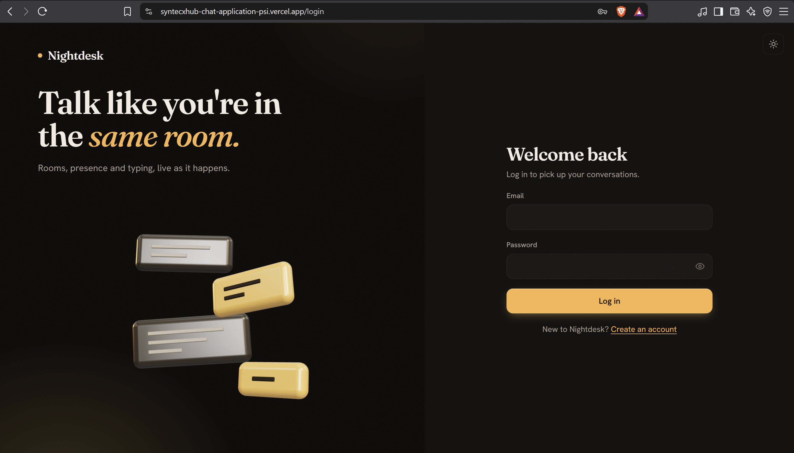
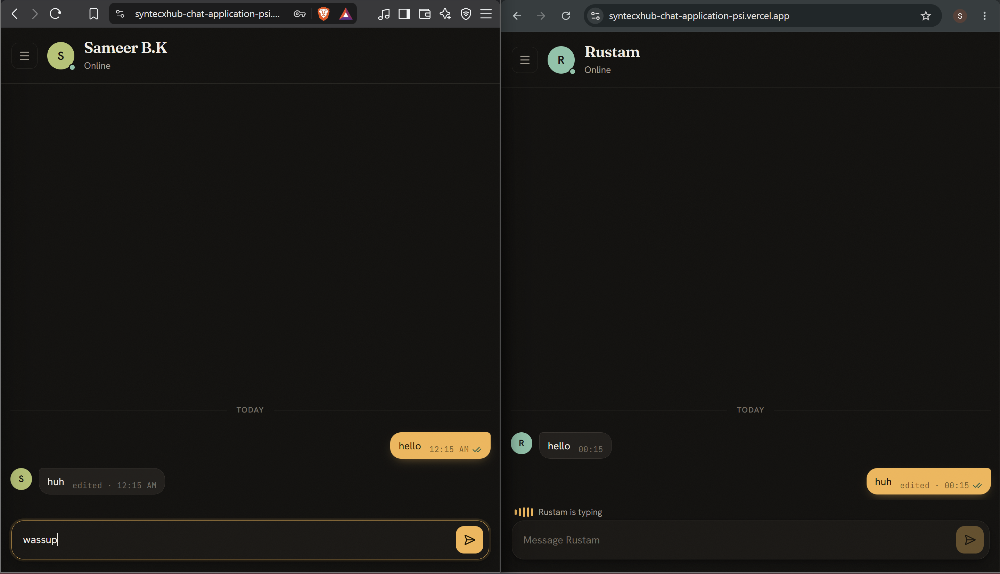
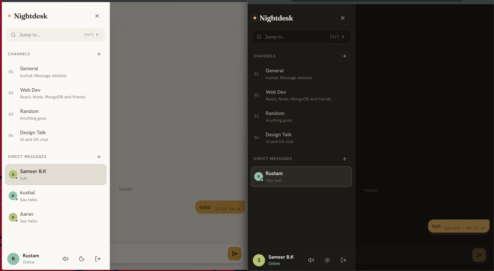

# Nightdesk: Real-Time Chat Application

A full-stack real-time chat app built with the MERN stack and Socket.io for the Syntecxhub Web Development internship (Task 4, Project 3).

**Live demo:** https://syntecxhub-chat-application-psi.vercel.app
**API health check:** https://syntecxhub-chat-server.onrender.com/api/health

> The server runs on a free Render instance, so the first request after inactivity can take up to a minute. To try the chat, open the demo in two windows (one normal, one incognito) and register two accounts.

## Screenshots





## Features

**Chat & Messaging**
- Real-time messaging with Socket.io, authenticated with JWT
- Public chat channels, and users can create new ones
- Private direct messages between two users
- **Private multi-user group chats** with member selection, custom titles, and live syncing
- **Media & image sharing** powered by Cloudinary with client preview, clipboard pasting (`Ctrl+V`), and lightbox zoom
- **Voice notes & audio messages** recorded directly in-browser with duration tracking, speed toggle (`1x`, `1.5x`, `2x`), and custom player
- **Pinned messages** with sticky banner in the conversation header for announcements and key notes
- **In-chat message search** (`Ctrl+F`) with real-time keyword highlighting and jump-to-message
- **User mentions** (`@username`) with autocomplete popover, highlighted mention tags, and dedicated notifications
- **Rich link previews** that automatically parse URLs and generate Open Graph cards with title, description, and thumbnail
- **Infinite scroll history pagination** that loads earlier messages seamlessly on scroll-up
- Chat history stored in MongoDB Atlas with indexed timestamps
- Typing indicators, online/offline presence, and unread badges
- Read receipts (sent and seen ticks) in direct messages and groups
- Edit your own messages, delete for me, or delete for everyone
- Message sounds synthesized via Web Audio API with saved mute settings
- Reply to any message, with a quoted preview that jumps to the original
- Emoji reactions, one per person per message, live for everyone
- Desktop notifications when a message arrives while the tab is in the background
- Profile settings: change your name, avatar color and password (name and color update live for everyone)

**Interface**
- Custom design system, with light and dark themes
- 3D animated login scene built with Three.js, with a fallback for devices without WebGL
- Ctrl+K command palette to jump to any channel, group, or person
- Smooth animations that respect the "reduce motion" setting
- Fully responsive layout with a slide-in sidebar on mobile

**Security & Scalability**
- Passwords hashed with bcrypt, JWT authentication on both REST and WebSocket connections
- Private conversations can only be read by their members
- Message edits and deletes verified on the server (sender-only access control)
- Helmet security headers, rate limiting on login/registration, and per-connection socket throttling
- Input validation on both client and server
- **Optional Redis adapter** for multi-instance horizontal scaling (`@socket.io/redis-adapter`) with automatic in-memory fallback

## Tech Stack

- **Frontend:** React 19 (Vite), React Router, Socket.io client, Motion, Three.js, Lucide icons
- **Backend:** Node.js, Express 5, Socket.io 4, Multer, Cloudinary SDK, Cheerio (Open Graph scraper), Redis client
- **Database:** MongoDB Atlas with Mongoose 9
- **Auth and security:** JWT, bcryptjs, helmet, express-rate-limit
- **Deployment:** Vercel (client), Render (server), MongoDB Atlas (database)

## How It Works

```
React app (Vercel)  <-- REST + WebSocket -->  Express + Socket.io (Render)  <-->  MongoDB Atlas
                                                       │
                                            (Optional Redis Pub/Sub)
```

1. Users register or log in over REST and receive a JWT.
2. The client opens a Socket.io connection and sends the token. The server verifies it before accepting the connection.
3. On connect, the server joins the user to every public room, group, and private chat they belong to.
4. Messages, voice notes, and media uploads are validated, stored in MongoDB Atlas / Cloudinary, and broadcast to the room.

## Run Locally

```bash
git clone https://github.com/rustamtimalsina/Syntecxhub_Chat_Application.git
cd Syntecxhub_Chat_Application
```

**Server**
```bash
cd server
npm install
```
Create `server/.env` (see `.env.example`):
```env
PORT=5001
MONGO_URI=your_mongodb_connection_string
JWT_SECRET=your_secret_key
CLIENT_URL=http://localhost:5173

# Cloudinary (for media uploads & voice notes)
CLOUDINARY_CLOUD_NAME=your_cloud_name
CLOUDINARY_API_KEY=your_api_key
CLOUDINARY_API_SECRET=your_api_secret

# Optional Redis
# REDIS_URL=redis://localhost:6379
```
```bash
npm run dev
```

**Client** (new terminal)
```bash
cd client
npm install
npm run dev
```
Open http://localhost:5173

## REST API

| Method | Endpoint | Auth | Description |
|---|---|---|---|
| POST | /api/auth/register | No | Create an account |
| POST | /api/auth/login | No | Log in and receive a token |
| GET | /api/auth/me | Yes | Current user |
| GET | /api/users?q= | Yes | Search people (name and color only) |
| GET | /api/conversations | Yes | Channels, groups, and direct messages |
| POST | /api/conversations/channels | Yes | Create a channel |
| POST | /api/conversations/dm | Yes | Start or reopen a direct message |
| POST | /api/conversations/groups | Yes | Create a private multi-user group chat |
| PATCH | /api/conversations/:id/members | Yes | Add, remove, or leave group members |
| GET | /api/conversations/:id/search?q= | Yes | In-chat message search |
| GET | /api/conversations/:id/pinned | Yes | Fetch pinned messages in conversation |
| GET | /api/conversations/:id/messages | Yes | Message history (?before=&limit=) |
| POST | /api/upload | Yes | Upload image/media/audio attachment (Cloudinary) |
| PATCH | /api/auth/profile | Yes | Change name and avatar color |
| PUT | /api/auth/password | Yes | Change password |

## Socket Events

| Event | Direction | Purpose |
|---|---|---|
| message:send, message:new | client to server, server to room | Send and receive messages, media, voice notes, mentions |
| message:edit, message:delete, message:updated | client to server, server to room | Edit or delete for everyone |
| message:pin, message:pinned | client to server, server to room | Pin or unpin message |
| message:hide, message:hidden | client to server, server to my tabs | Delete for me |
| typing | both | Typing indicator |
| presence:list, presence:update | server to clients | Online users |
| conversation:read | both | Read receipts |
| conversation:created | server to clients | New channels, groups, and chats appear live |
| group:updated, group:removed | server to clients | Group member membership live sync |
| message:react, message:reacted | client to server, server to room | Emoji reactions |
| user:updated | server to clients | Name and avatar changes appear live |

## Author

Rustam Timalsina
